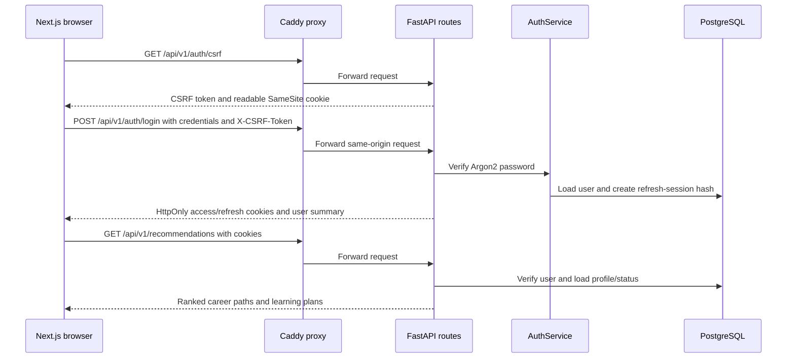

# Authentication and request flow

This repository contains the original Spring Boot authentication code and a new FastAPI service. The Java implementation remains available as the baseline; the FastAPI service is the deployable path used by the new Next.js dashboard.

## Existing Spring Boot implementation

The current Java flow is implemented in [AuthController.java](https://github.com/vighneshmagdum/upthrive-backend/blob/main/src/main/java/com/vm/upthrive/controller/AuthController.java), [SecurityConfig.java](https://github.com/vighneshmagdum/upthrive-backend/blob/main/src/main/java/com/vm/upthrive/config/SecurityConfig.java), [JwtFilter.java](https://github.com/vighneshmagdum/upthrive-backend/blob/main/src/main/java/com/vm/upthrive/security/JwtFilter.java), [JwtService.java](https://github.com/vighneshmagdum/upthrive-backend/blob/main/src/main/java/com/vm/upthrive/security/JwtService.java), and [UserServiceImpl.java](https://github.com/vighneshmagdum/upthrive-backend/blob/main/src/main/java/com/vm/upthrive/service/implementation/UserServiceImpl.java).

### Components

- AuthController exposes POST /auth/register and POST /auth/login.
- UserServiceImpl saves accounts through JPA and encodes each submitted password with the configured PasswordEncoder.
- SecurityConfig makes the service stateless, permits /auth/** and Swagger routes, requires authentication for other requests, and installs JwtFilter before Spring's username/password filter.
- CustomUserDetailsService looks up a user by email and maps the stored role to Spring authorities.
- JwtService signs a JWT whose subject is the user's email.
- UserController exposes user CRUD routes; deleting a user additionally requires ADMIN.

### Request flow

1. Registration sends name, email, password, and role to POST /auth/register. The service BCrypt-encodes the password and stores the user.
2. Login sends email and password to POST /auth/login. AuthenticationManager delegates to a DAO provider, which loads the account and checks the submitted password against its stored BCrypt hash.
3. A successful login returns a one-hour JWT in JSON: { "token": "..." }.
4. The client sends later requests with Authorization: Bearer <token>.
5. JwtFilter extracts the bearer token. JwtService parses and verifies the signature and token lifetime; the filter reloads the user's email and authorities and puts an authenticated principal in Spring's SecurityContext.

The password travels in the HTTPS request body during registration and login. The stored value is BCrypt encoded; UserResponse does not include the password. The JWT is signed, not encrypted, and carries the email subject plus issued-at and expiry timestamps. Its payload should not be treated as secret.

### Current security limits

- JwtService uses a hard-coded signing key and gives tokens a one-hour lifetime. There is no refresh-token or server-side logout/revocation flow.
- The client storage location for the JSON token is not specified in this repo; a browser client should not put it in local storage.
- UserRequest includes a caller-supplied role, and public registration passes it directly to persistence. Spring's user-details builder turns that stored value into a role authority, so public signup must not be allowed to grant ADMIN.
- src/main/resources/application.properties contains a fixed database password, enables SQL logging, and uses automatic schema updates. Those are development settings, not deployment secrets.
- CSRF is disabled in the stateless Spring filter chain. That fits bearer-token authentication but would need reconsideration if the old API is changed to use cookies.

## FastAPI service added in this branch

The FastAPI service is under backend/app. It uses separate route, service, model, and schema layers.

### Request flow

- Passwords are Argon2id hashed before persistence. No endpoint returns a password hash.
- Access JWTs last 15 minutes by default and are held in an HttpOnly cookie. The token contains a UUID subject, issuer, issue/expiry times, token ID, and access-token type.
- Refresh tokens are random opaque values. Only a SHA-256 hash is stored in refresh_sessions; refresh rotates the token and revokes the old one. Logout revokes the current refresh session.
- Cookies are SameSite=Lax. Secure is enabled when ENVIRONMENT=production or can be set explicitly. The refresh cookie is scoped to /api/v1/auth.
- State-changing requests require a double-submit CSRF token: the browser sends the readable upthrive_csrf cookie value in X-CSRF-Token. Access and refresh cookies remain HttpOnly.
- The JWT signing key and database URL are read from environment variables. Use HTTPS, a unique strong JWT_SECRET, a private database, and secure cookies for production.

The core implementation is in [security.py](../backend/app/core/security.py), [dependencies.py](../backend/app/api/dependencies.py), [auth_service.py](../backend/app/services/auth_service.py), and [auth.py](../backend/app/api/routes/auth.py).
